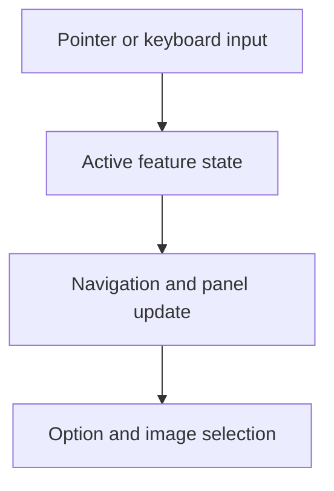

# Mobile Product Feature Explorer

An interactive feature-navigation component with phone-specific gestures, desktop navigation, option switching and accessible tab behavior.

**Technical showcase · Documentation only · Anonymized**

Shopify | Liquid | JavaScript | CSS | Pointer Events | Playwright

## Engineering problem

Touch, keyboard and button input should lead to the same coherent active-panel state. Phone-specific behavior must not leak into tablet and desktop layouts.

## Implementation scope

- Built generated feature navigation with tab semantics and Arrow, Home and End keyboard support.
- Implemented option switching and corresponding product-image changes.
- Added phone-specific pointer-drag behavior and previous/next controls.
- Kept mobile interaction logic distinct from larger-screen behavior.
- Prepared an anonymized presentation with checks for initialization, active panels, local image references and horizontal overflow.

## Architecture at a glance

The following is an illustrative technical flow, not a client screenshot or a deployment topology.

## Evidence and delivery boundary

Implemented component and anonymized local presentation; production deployment is not asserted.

The local presentation includes Playwright coverage for narrow and wide layouts, active-panel behavior and overflow. Its tests and appearance are not evidence of a production theme launch or physical-device touch certification.

## Read more

- [Engineering decisions](docs/engineering.md)
- [Scope and evidence boundaries](docs/scope.md)

> This repository describes verified implementation work at a technical level. Original source, identities, business data and visual assets are intentionally omitted. It is not an installable application or a claim that the original private implementation is open source.
