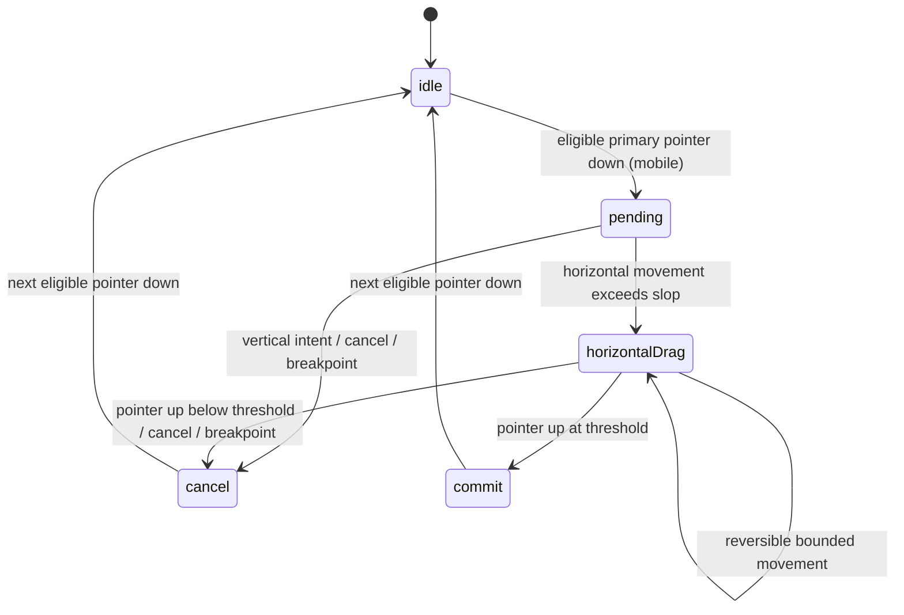

# Engineering decisions

## One selection authority

Every selection path dispatches to `createExplorer()`. The browser adapter does not maintain a parallel active index, so a tab click, button press, keyboard command, and completed drag cannot disagree about the selected feature.

## Gesture lifecycle

`commit` and `cancel` are observable terminal outcomes, not long-running animation states. A subsequent eligible pointer down starts a fresh `pending` gesture.

## Axis lock and native scrolling

The mobile viewport declares `touch-action: pan-y`. The adapter does not prevent the initial down or sub-slop moves. Once horizontal displacement wins the axis comparison, state reports `preventDefault: true`; only then does the adapter prevent the move. A vertical-dominant move cancels ownership immediately, leaving vertical scrolling native.

## Pointer ownership and click safety

Only a primary, left-button pointer may acquire ownership. Events from other pointer IDs are ignored. Pointer down originating inside a button is not captured, preserving intended tab and navigation clicks. A completed drag suppresses the synthetic click that may follow; cancellation, capture loss, and the next accepted pointer down clear stale suppression. The adapter deliberately releases owned capture when a gesture is cancelled, the breakpoint changes, discrete navigation takes over, or the instance is destroyed.

A `lostpointercapture` event after a legitimate `pointerup` cannot undo a commit: `pointerup` clears the owner, and the later event no longer matches any owner.

## Selection versus focus

- Arrow, Home, and End select and focus the resulting tab. That focus request is consumed immediately and is not replayed by later pointer renders.
- Clicking a tab selects it while the browser naturally leaves focus on that clicked tab.
- Previous/next controls and gestures change selection without moving focus.
- Palette changes preserve the selected feature and focus.

The tablist has one keydown handler, preventing duplicate advancement.

## Width, breakpoints, reduced motion, and teardown

The adapter reads the current viewport rectangle on every pointer down, move, and up. Commit uses the pointer-up coordinates and actual release width, so a final reversal or threshold crossing is honored even when no final `pointermove` arrives. Leaving the mobile media query cancels an in-progress drag and future pointer gestures are ignored at larger widths.

The adapter always derives `count` from the rendered tab/panel pairs and `mobile` from its media query after applying optional state-machine tuning. Callers cannot override those two DOM/browser facts through adapter options.

CSS removes the track transition under `prefers-reduced-motion: reduce`; state transitions remain identical. `mountFeatureExplorer()` returns `destroy()`, which removes every DOM/media listener and disposes the controller.

## Shopify section mapping (not implemented)

A production theme integration could map section blocks to feature definitions, preserve generated IDs and ARIA relationships, and mount one adapter per section root. Theme-editor unload would call `destroy()`. Product data, Liquid schema, editor events, and theme packaging are deliberately outside this demonstration.
